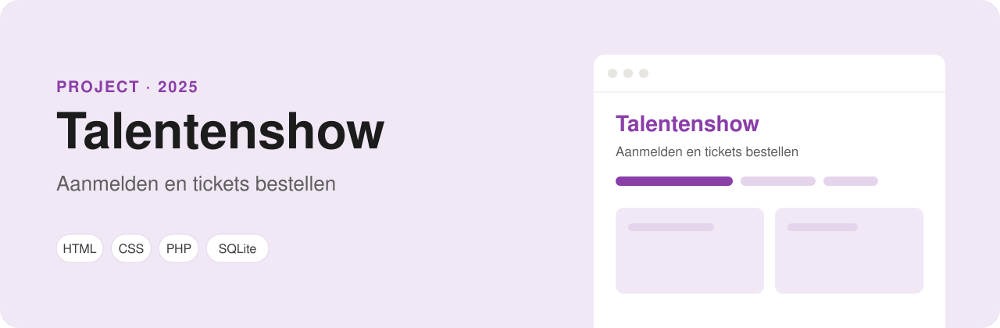

<p align="center">
  
</p>

<p align="center">
  
  
  
  
</p>

# Talentenshow

Een website voor een talentenshow: je leest wat de show is, meldt je aan als deelnemer en bestelt tickets. Dit was mijn eerste project met alles erin: HTML, CSS, een formulier in PHP en een database.

## Pagina's

| Pagina | Wat je er doet |
| --- | --- |
| `index.html` | De homepage met uitleg over de show |
| `aanmelden.html` | Je aanmelden als deelnemer |
| `bestellen.html` | Tickets bestellen |

## Hoe het werkt

- Het bestelformulier gaat naar `connect.php`. Dat bestand controleert of alle velden zijn ingevuld, kijkt of het e-mailadres klopt en slaat de bestelling op in de tabel `bestelen` met een **prepared statement** (PDO).
- Het aanmeldformulier gaat naar `aanmelden.php` en slaat de deelnemer met zijn categorie (zingen, dansen, comedy of goochelen) op in de tabel `aanmeldingen`.
- Na het versturen krijg je een bedankpagina in de stijl van de site. De databaseverbinding staat in `db.php`.
- De site is responsive. Op een telefoon klapt het menu in tot een hamburgerknop (`app.js`).
- Alle opmaak staat in `style.css`, zonder framework.

## Zelf draaien

Je hebt een lokale webserver met PHP en MySQL nodig, bijvoorbeeld XAMPP.

1. Clone het project in de map van je webserver:
   ```bash
   git clone https://github.com/ParisAngelopoulos/Talentenshow.git
   ```
2. Maak in phpMyAdmin een database aan met de naam `talentenshow`.
3. Importeer daarin het bestand `talentenshow.sql`. Daarin staan al 8 ticketbestellingen en 6 aanmeldingen.
4. Ga naar http://localhost/Talentenshow.

---

Gemaakt door **Paris Angelopoulos**, web developer in opleiding · [GitHub](https://github.com/ParisAngelopoulos) · [parisangelopoulos@gmail.com](mailto:parisangelopoulos@gmail.com)
